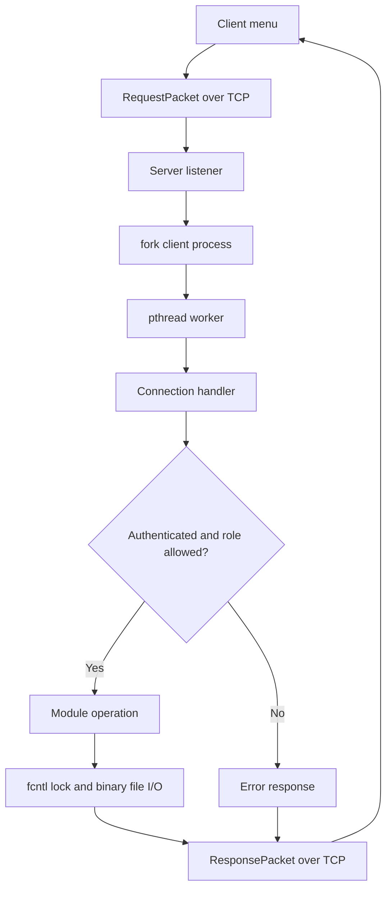

# Architecture Blueprint

## Module responsibilities

| Module | Responsibility |
|---|---|
| `client/main.c` | Terminal menus for customer, employee, manager, administrator |
| `common/network.c/.h` | Exact send/receive of fixed-size request/response packets |
| `common/protocol.h` | Request opcodes, status codes, payload structures |
| `common/models.h` | User, account, transaction, loan, and feedback record definitions |
| `server/main.c` | TCP listener, process creation, worker thread, semaphore, zombie reaping |
| `server/connection_handler.c` | Authentication session state, role authorization, opcode dispatch |
| `server/auth.c/.h` | Login, logout, password changes |
| `server/db.c/.h` | POSIX binary-file storage and record CRUD |
| `server/lock.c/.h` | `fcntl()` record locks, one-session enforcement, ordered transfer locks |
| `server/customer_ops.c/.h` | Balance, deposits, withdrawals, transfers, passbook |

## Request flow

## Storage model

- `users.dat`: `UserRecord` records
- `accounts.dat`: `AccountRecord` records
- `transactions.dat`: `TransactionRecord` ledger entries
- `loans.dat`: `LoanRecord` applications and decisions
- `feedback.dat`: `FeedbackRecord` customer feedback

Each `.dat` file is a sequence of fixed-size C structures. The files are not a relational database and should only be edited through the program or reset using the documented seed procedure.
